# User guide

Kanji Practice helps you drill the readings of the kanji and vocabulary you study in [WaniKani](https://www.wanikani.com). You type the reading, the app tells you whether it is right, and then shows the meanings, readings and mnemonics.

> The screenshots were taken from the running app (v2.14.0) in a 1280 px wide browser window (390 px for the phone screens). Your username and API key are masked.

## What you need

- A WaniKani account.
- A WaniKani **API token**. A read-only token is enough: the app only reads your profile, subjects and assignments, and never changes anything on WaniKani.
- A modern desktop or mobile browser with an internet connection.

## 1. Get started

1. Open the app and go to **Settings**. Until you have a valid key, Settings is the only page.
2. In WaniKani, open your account settings, go to API tokens and create or copy a token.
3. Paste the token into **API Key** and click **Save**.

   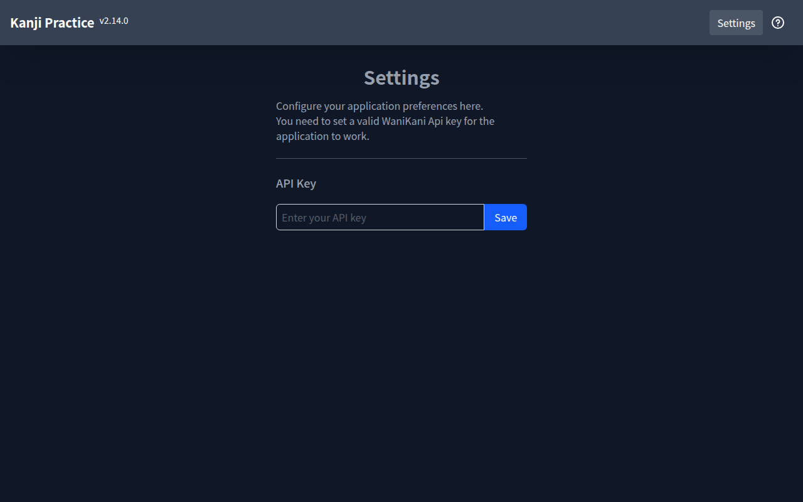

4. The app checks the token while the "Updating data..." screen is shown. If it is valid, your username replaces "Settings" in the top bar and the **Kanji**, **Vocabulary** and **Marked Items** links appear.
5. The first time, the app downloads all WaniKani content. A full-screen message "Updating data... (N resources loaded)" shows progress. Later starts only fetch what changed.

   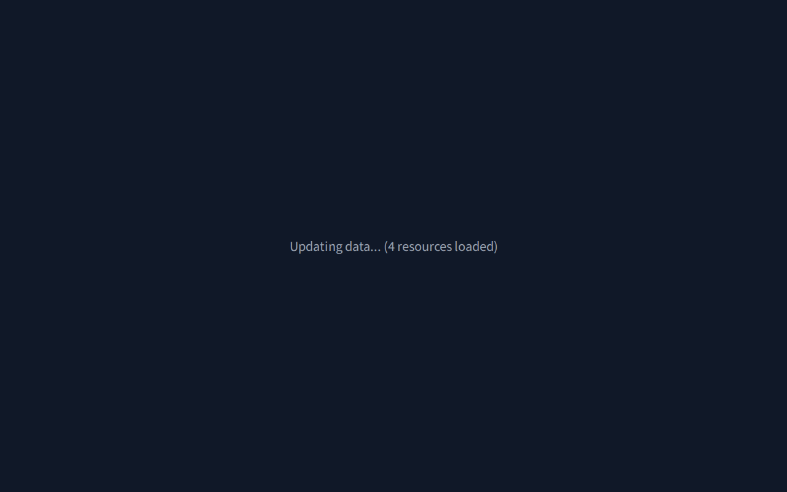

If the key is wrong, nothing else shows up. Check the token and save again.

## 2. The top bar

| Item             | What it does                                                              |
| ---------------- | ------------------------------------------------------------------------- |
| Kanji            | Practice kanji readings                                                   |
| Vocabulary       | Practice vocabulary readings                                              |
| Level            | Choose the WaniKani level to practice, from 1 up to your current level    |
| Marked Items (n) | Practice the items you marked, from any level. `n` is how many you marked |
| Your username    | Opens Settings                                                            |
| `?` icon         | Opens the help overlay                                                    |

The version number is shown next to the app name.

## 3. Practising

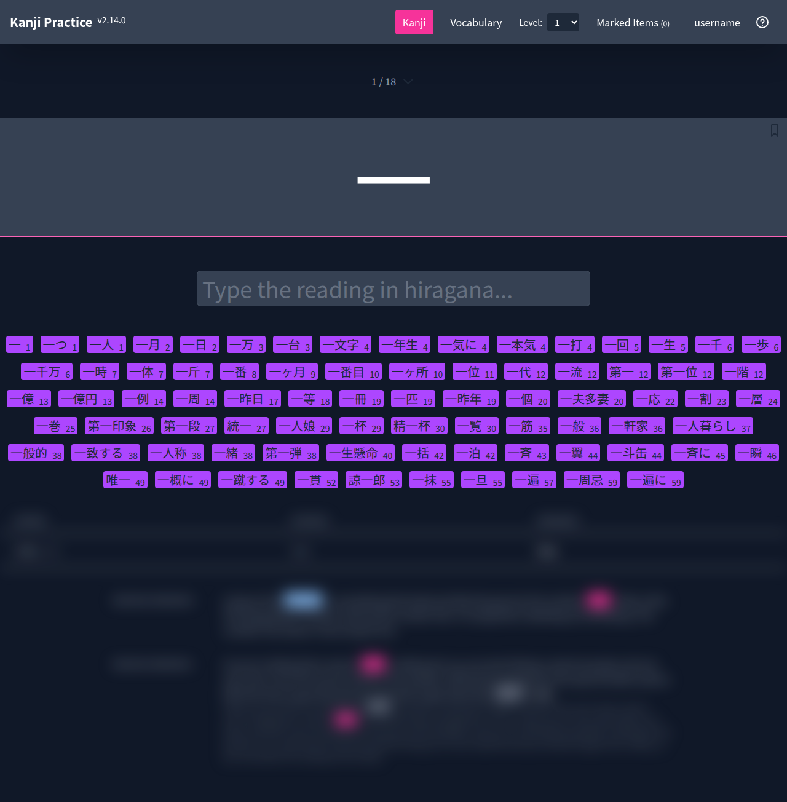

From top to bottom the page shows:

1. **Position** such as `1 / 18`: the current item and the number of items in the list. The small arrow next to it opens the full item list.
2. **The kanji or word** in a large box. The bookmark icon at the top right marks the item. Vocabulary items also have a speaker icon for the audio.
3. **A thin progress line** under that box. It grows with the share of the list you have answered correctly.
4. **The answer field**: "Type the reading in hiragana...".
5. **Related vocabulary** (kanji pages only): the words that use this kanji, each with its WaniKani level. Hover a word to see its meaning and reading, click it to hear it.
6. **The details panel**, blurred until you answer.

### Answering

Type the reading in romaji. It turns into hiragana as you type. Use `nn` for ん.

Press **Enter**:

- **Red border**: wrong. Edit the answer and press Enter again.
- **Green border and a check mark**: correct.

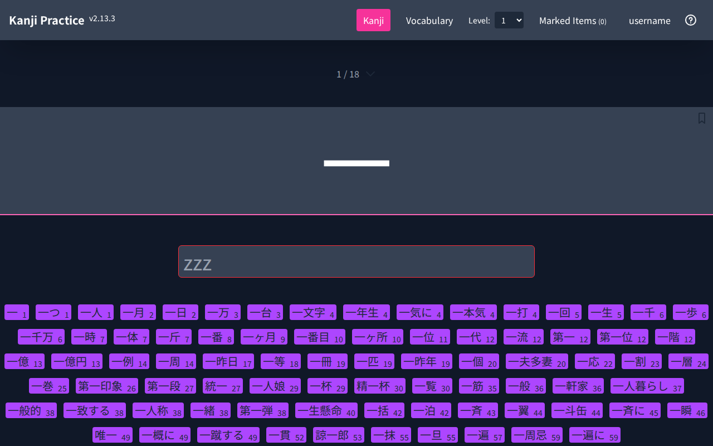

Press **Enter** again after a correct answer to jump to the next item you have not answered yet.

Your answers only count for the current session. They reset when you change the level, section or settings, and when you reload the page.

### Which readings count

- Kanji: any reading WaniKani accepts for the item.
- Vocabulary: the accepted readings. A reading written in katakana can be typed in hiragana.
- Kana-only words: the word typed in hiragana.

### The details panel

The details are blurred until you answer correctly. Click the panel or press **Alt+S** to show or hide them.

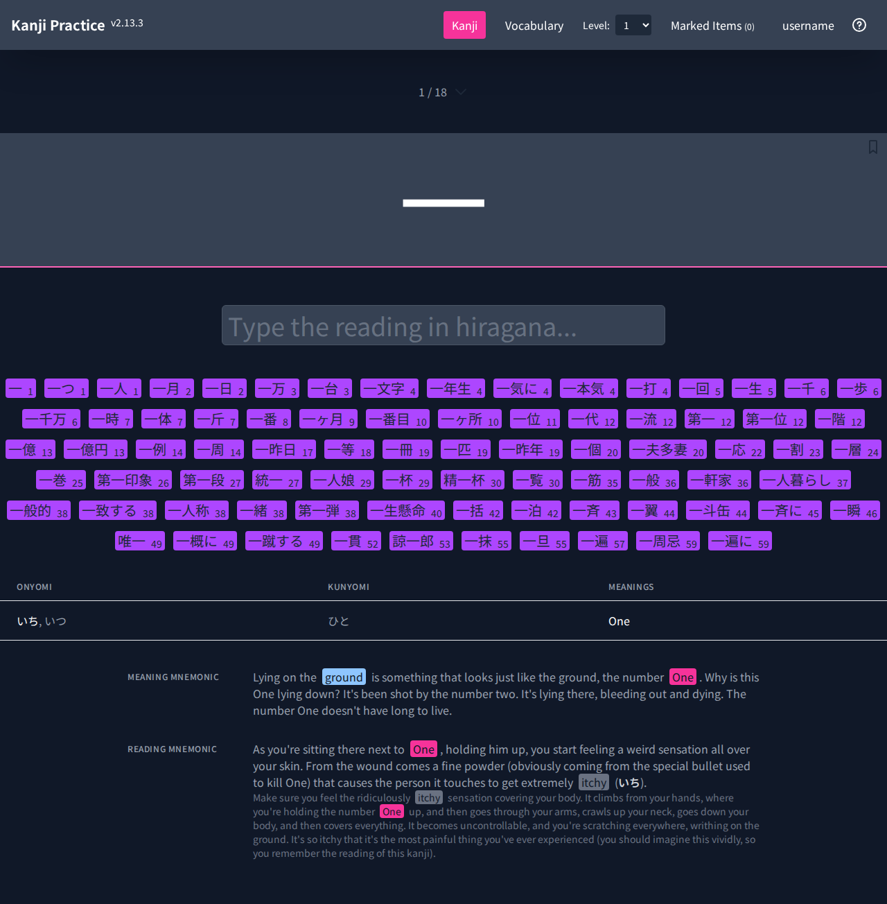

For a kanji you get its on'yomi, kun'yomi and meanings, plus the meaning and reading mnemonics.

For a vocabulary item you get its reading, meanings, the kanji it is made of (composition), the mnemonics and example sentences. The English translations of the sentences are blurred too.

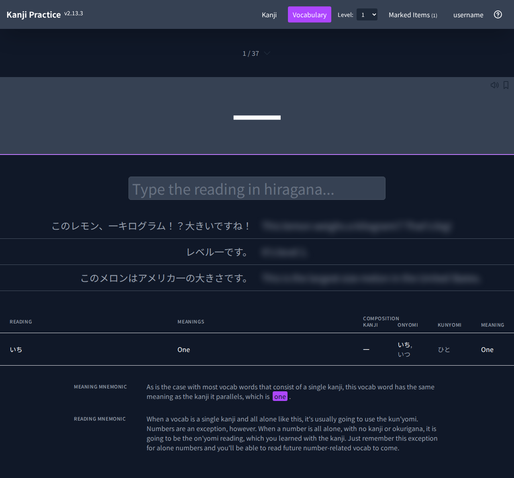

### The item list

Click the arrow next to the position, or press **Alt+A**, to see every item in the current level. Each item has a circle icon in front of it. Pick an item to jump to it. Close the list with **Esc** or the close button.

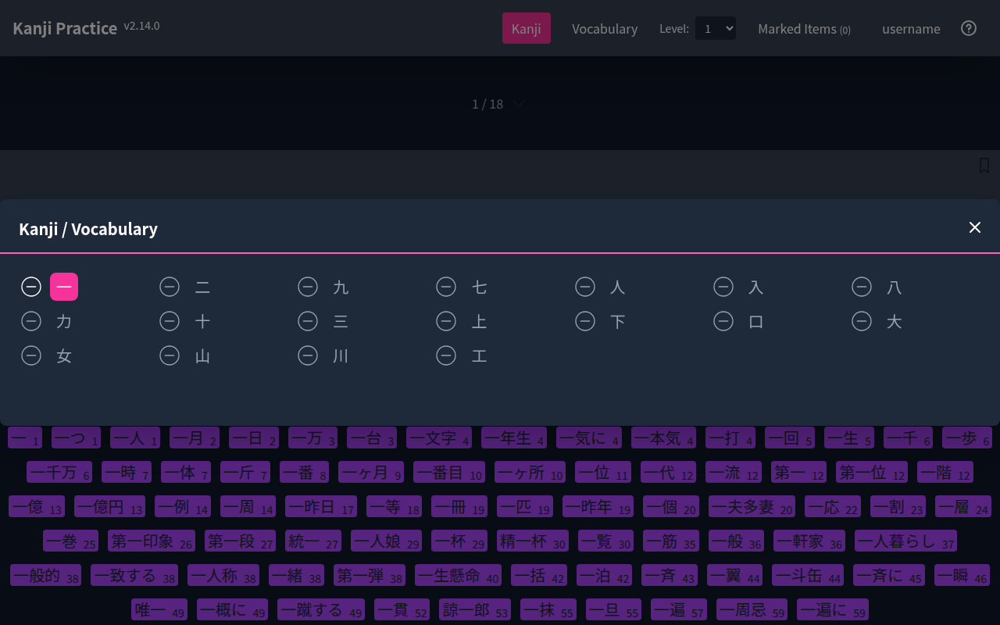

### Moving around

- **Left / Right arrow**: previous or next item (with the list closed).
- **Level** dropdown or **Alt+Up / Alt+Down**: change level.

## 4. Marking items

Mark items you find hard and come back to them:

- Click the bookmark icon, or press **Alt+M**.
- The **Marked Items (n)** count in the top bar goes up.
- Open **Marked Items** to practice only those items, from every level.

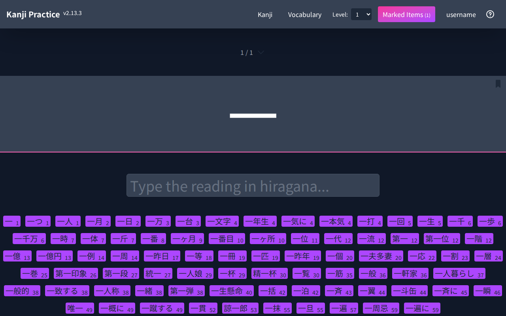

If nothing is marked, the page shows "Sorry, couldn't find any items to show."

## 5. Settings

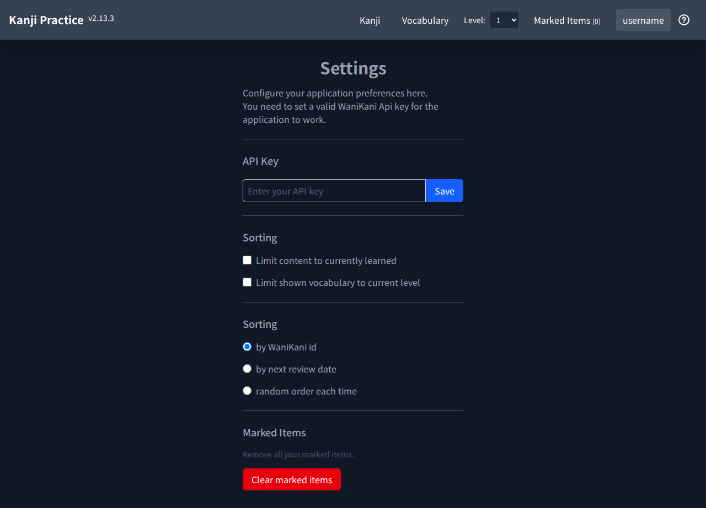

| Setting                                 | Effect                                                                                                |
| --------------------------------------- | ----------------------------------------------------------------------------------------------------- |
| API Key                                 | The WaniKani token. Click **Save** after changing it.                                                 |
| Limit content to currently learned      | Only show items you have already started in WaniKani.                                                 |
| Limit shown vocabulary to current level | Under a kanji, hide related words above your WaniKani level.                                          |
| Sorting: by WaniKani id                 | The standard WaniKani order (default).                                                                |
| Sorting: by next review date            | Items due soonest come first. Items without a review date go last.                                    |
| Sorting: random order each time         | A new random order every time you click **Kanji**, **Vocabulary** or **Marked Items** in the top bar. |
| Clear marked items                      | Removes all your marks. This cannot be undone.                                                        |

The Settings page puts both the two checkboxes and the sort options under a heading called "Sorting". The checkboxes are the first block.

Settings are saved automatically in your browser.

## 6. Help overlay

The `?` icon in the top bar opens a short summary of the shortcuts. Close it with **Esc**, the close button, or a click outside it.

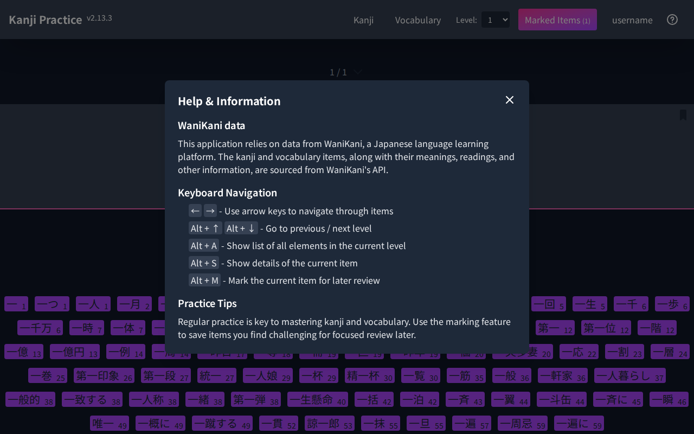

## 7. Phones and small screens

Below the large-screen breakpoint the top bar collapses into a menu button. The menu holds the same links, the level selector and the help icon.

| Page                                 | Menu                                      |
| ------------------------------------ | ----------------------------------------- |
| 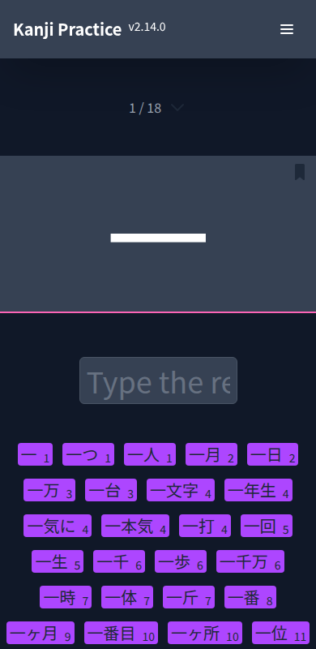 | 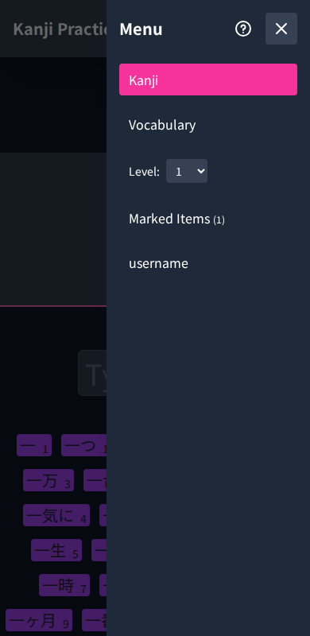 |

The keyboard shortcuts need a keyboard, so on a phone use the on-screen controls.

## 8. Keyboard shortcuts

| Key          | Action                                        |
| ------------ | --------------------------------------------- |
| Enter        | Check the answer, then go to the next item    |
| Left / Right | Previous / next item                          |
| Alt + Up     | Previous level (wraps to your highest level)  |
| Alt + Down   | Next level (wraps to level 1)                 |
| Alt + A      | Open or close the list of items in this level |
| Alt + S      | Show or hide the details                      |
| Alt + M      | Mark or unmark the current item               |
| Esc          | Close the help overlay, menu or item list     |

## 9. Troubleshooting and FAQ

**Only Settings is available.**
No key is saved, or WaniKani rejected it. Create a new token and save it again.

**The list is empty.**
Check that the level has items and turn off **Limit content to currently learned** if you have not started that level in WaniKani. The Marked Items page is empty until you mark something.

**New or changed WaniKani items are missing.**
After a reload, the app checks WaniKani for changes at most every 12 hours. Until then it only checks your account, so changes made on WaniKani can take up to 12 hours to appear. There is no refresh button. To check right away, log out and clear local data in Settings, then enter your key again. This also removes your marked items. Next-review sorting and **Limit content to currently learned** can lag up to 12 hours behind reviews you have done on WaniKani.

**The latest WaniKani data is missing after startup.**
If sync fails, the app opens with the data stored on this device and shows a red banner with a **Try again** button. Check your connection and key, then click it. A sync that was interrupted never skips data: the next one starts again from the last complete sync.

**Does the app change my WaniKani progress?**
No. Answers here are not sent to WaniKani and do not count as reviews.

**Is my token safe?**
The token is stored unencrypted in your browser's local database (IndexedDB) and sent only to `api.wanikani.com`. The Settings field shows it in plain text, so be careful with screen sharing. On a shared computer, use a read-only token and revoke it when you are done.

**Does it work offline?**
No. The app needs a connection to load.
